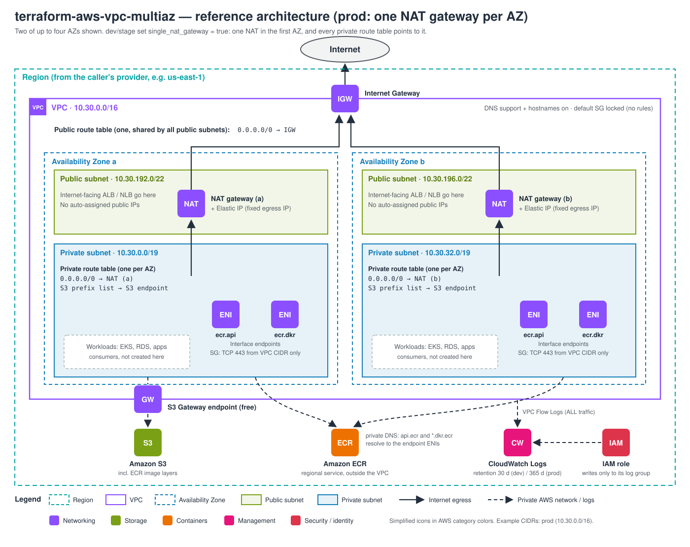
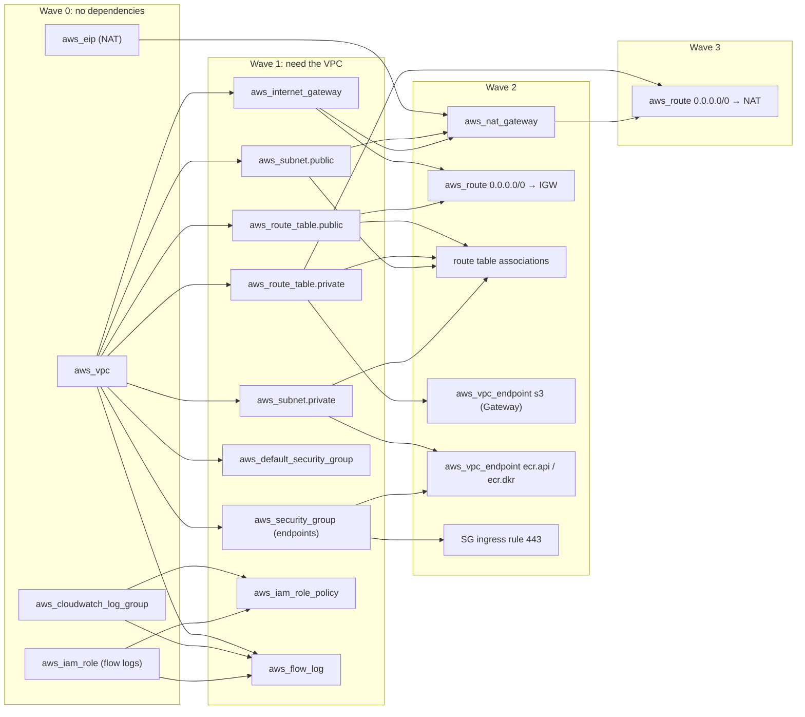

# Build guide: what gets built first, and why

This guide explains the project in two orders:

1. **Authoring order**: how to write this repository from scratch, step by step.
   Each step only depends on what the previous steps already defined.
2. **Provisioning order**: the order Terraform creates the AWS resources in,
   derived from the real dependency graph (`terraform graph`).

---

## 1. Authoring order (how to build the repository)

The commit history follows these steps, so `git log --reverse` shows the same path.

| Step | Files | What | Why it comes here |
|---|---|---|---|
| 0 | — | **Design on paper**: CIDR plan per environment, subnet sizes, naming convention, NAT strategy | Everything else encodes these decisions. Changing a CIDR after `apply` means recreating the network, so it is decided first. |
| 1 | `.gitignore`, `modules/vpc/versions.tf` | Repo skeleton and version constraints | State and `*.tfvars` must be ignored **before** the first `terraform init`, so they can never be committed by accident. |
| 2 | `variables.tf`, `locals.tf` | Inputs with validation; naming and tagging locals | They are the module's contract. Every resource reads names, tags and CIDRs from here, and bad inputs fail at plan time, before AWS is called. |
| 3 | `vpc.tf` | VPC, Internet Gateway, locked default SG, public and private subnets | The VPC is the root of the graph: every other network resource needs its ID. Subnets come next because NATs, routes and endpoints are placed *in* subnets. |
| 4 | `routing.tf` | Route tables, Elastic IPs, NAT gateways, routes | Needs public subnets (a NAT lives there) and the IGW (a NAT is useless without it). Private routes need the NATs. |
| 5 | `endpoints.tf` | S3 Gateway endpoint, ECR Interface endpoints and their SG | The S3 endpoint attaches to the **private route tables**, and the ECR endpoints place ENIs in the **private subnets**, so both must exist first. |
| 6 | `flow_logs.tf` | CloudWatch log group, least-privilege IAM role, flow log | Observability goes last in the module: it only needs the VPC ID, and it is optional (`enable_flow_logs`). |
| 7 | `outputs.tf` | IDs and maps for consumers | Written once the resources exist; it is the API other stacks (EKS, RDS, ALB) use. |
| 8 | `envs/dev`, `envs/stage`, `envs/prod` | Root configs: provider, account guard, module call with per-env values | A module does nothing until a root config calls it. The provider (and so the region) lives here, never in the module. |
| 9 | `modules/vpc/tests/` | `terraform test` with a mocked AWS provider | Locks in the design decisions (CIDR layout, NAT routing, tags) so a later change cannot silently break them. Runs with no credentials. |
| 10 | `.tflint.hcl`, `.github/workflows/ci.yml` | Lint, security scan and tests on every PR | Automates steps 2–9 as a gate: `main` is protected and only accepts changes that pass CI. |
| 11 | `README.md`, `docs/` | Usage, security, cost, diagrams | Documents what was actually built, so it is written last and kept in sync. |
| 12 | `e2e/aws/` | Real-account test: probe instance in a private subnet, checks, destroy | Mocked tests prove the plan; only a real apply proves AWS accepts it and traffic flows. Run by hand (it costs money), not in CI. |

### Key decisions made in step 0

| Decision | Choice | Reason |
|---|---|---|
| One VPC per environment | dev 10.10/16, stage 10.20/16, prod 10.30/16 | Non-overlapping ranges can be peered or joined through a Transit Gateway later. |
| Subnet sizes | private /19, public /22 | Workloads (EKS gives each pod a VPC IP) need room; public subnets only hold load balancers and NATs. |
| Subnet CIDR source | AZ **letter**, not list position | Editing the AZ list never changes, and never recreates, other subnets. |
| NAT strategy | dev/stage: 1 shared; prod: 1 per AZ | NAT is the main cost. Prod pays for AZ independence; dev/stage accept a cross-AZ dependency. |
| Region | inherited from the caller's provider | The same module works in any region without a `region` input. |

---

## 2. Provisioning order (what Terraform creates first)

Terraform builds a dependency graph from the references between resources and
creates everything it can **in parallel**, wave by wave. A resource starts only
after everything it references exists.

| Wave | Resources | Why they wait |
|---|---|---|
| 0 | VPC, Elastic IPs, log group, IAM role | They reference nothing else in this module. |
| 1 | IGW, subnets, route tables, security groups, flow log, IAM policy | Every one of them needs `vpc_id` (the IAM policy needs the log group ARN). |
| 2 | NAT gateways, public default route, associations, endpoints, SG rule | A NAT needs its EIP, a **public** subnet and an attached IGW (`depends_on`). Endpoints need the private subnets / route tables and the SG. |
| 3 | Private default routes | They point at a NAT gateway, so they wait for it. **NAT creation is the slowest step** (a couple of minutes), and it sits on the critical path. |

**Destroy** runs the same graph in reverse: private routes first, then NATs and
endpoints, and the VPC last. An EIP is released only after its NAT is deleted.

### What happens before the first `apply`

1. `aws sts get-caller-identity` shows the target account.
2. `terraform init` downloads the exact provider build pinned in `.terraform.lock.hcl`.
3. `terraform plan` validates every input and checks `allowed_account_ids`: a wrong account or bad CIDR fails here, with nothing created.
4. Review the plan (dev = 28 resources), then `terraform apply` that saved plan.

### Verify after `apply`

- Running `terraform plan` again shows `No changes` (idempotency).
- From a private instance: `curl -s https://checkip.amazonaws.com` returns one of `nat_public_ips`.
- `nslookup api.ecr.<region>.amazonaws.com` from inside the VPC returns **private** IPs (the endpoint ENIs).
- Flow Logs appear in `/aws/vpc-flow-logs/<project>-<env>-<region>` within a few minutes.

[`e2e/aws/`](../e2e/aws/README.md) automates these checks (plus S3 through the gateway endpoint) and destroys everything afterwards.
